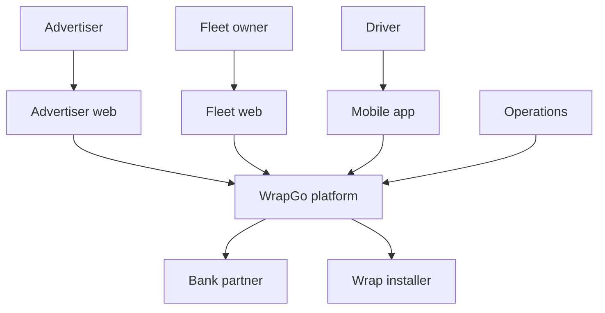
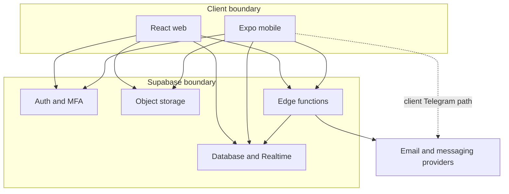
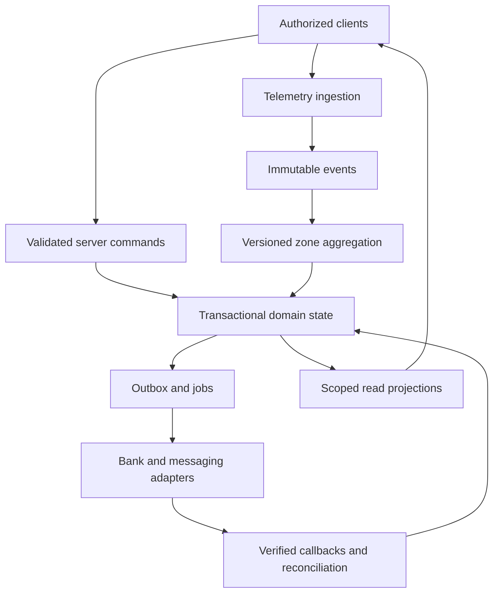
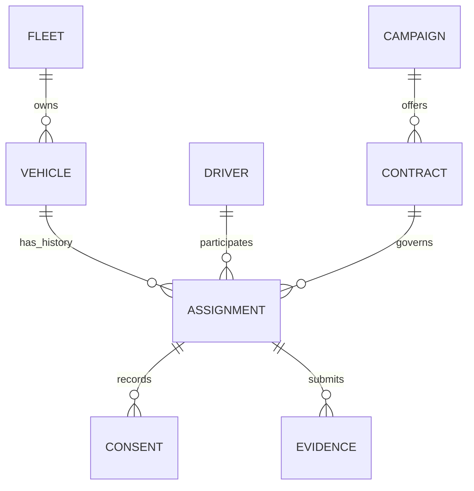
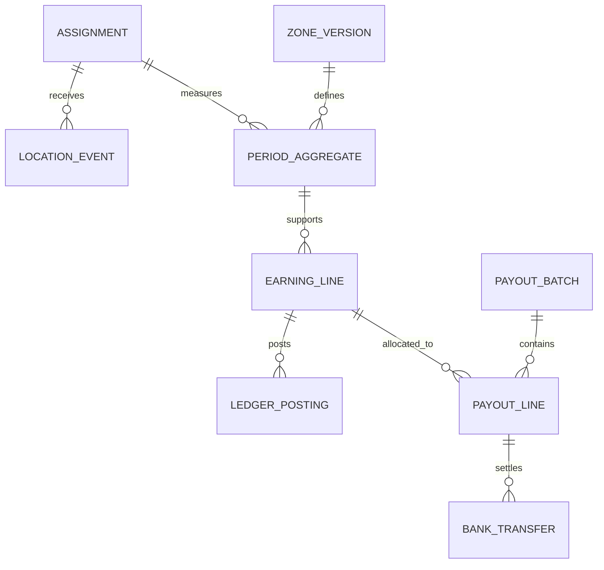
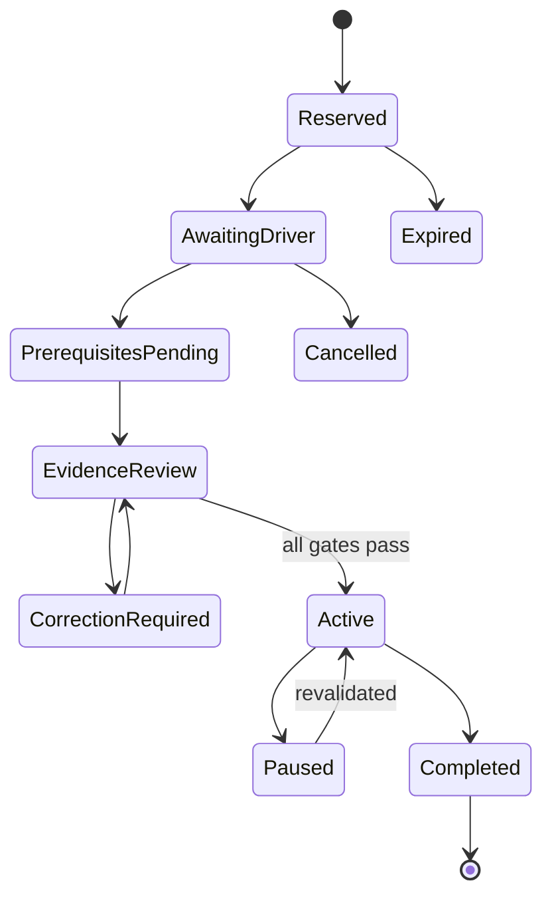
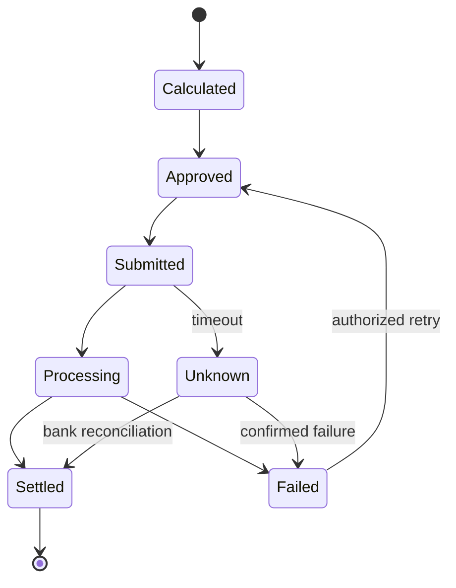
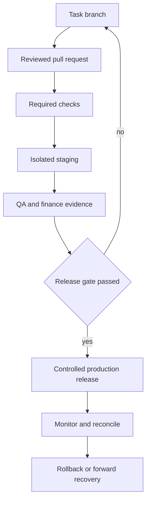
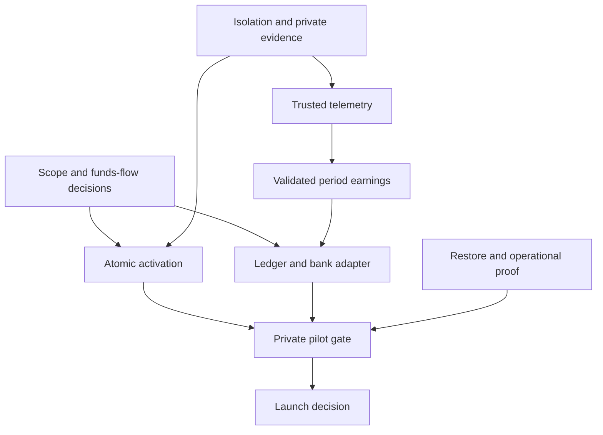
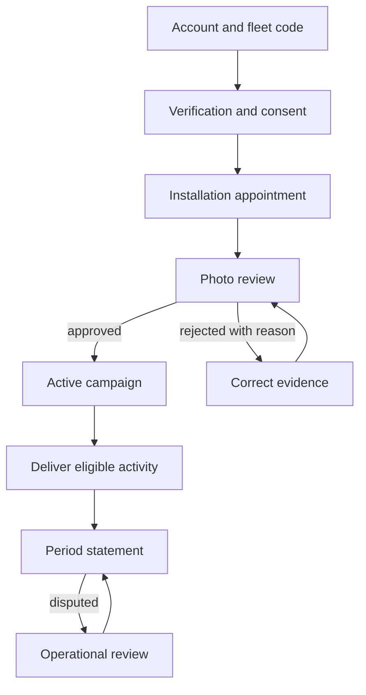

# Architecture and delivery diagrams

Each diagram has a single purpose. “Observed” is source behavior at pinned snapshots; runtime configuration is unverified. “Proposed” requires implementation and review. Fishbone is rendered separately as [SVG](fishbone.svg).

## 1. System context — product scope



## 2. Observed application containers and trust boundaries



Authorization inside DB/storage and deployed function config remain unknown. Bank processing is not shown as an observed connected container because it was not verified.

## 3. Proposed authoritative backend



## 4. Proposed logical assignment model



Stable UUID relationships replace using a temporary invite code as vehicle identity. Uniqueness constraints prevent prohibited overlapping assignments. Tenant memberships and authorization tables are omitted from this focused view.

## 5. Proposed measurement and settlement lineage



Allocation and retry cardinalities need schema review; business keys prevent paying an earning twice. Raw events plus aggregation rule/version must reproduce each earning line.

## 6. Proposed assignment lifecycle



Driver consent, identity check, installation and funding are separate prerequisite records. The diagram does not imply photo submission is consent or that a fleet owner can approve for a driver.

## 7. Proposed redemption sequence and race handling

```mermaid
sequenceDiagram
  participant D as Driver app
  participant API as Command API
  participant DB as Database
  participant O as Outbox
  D->>API: Redeem code with idempotency key
  API->>API: Authenticate and rate limit
  API->>DB: Begin transaction; lock invitation
  DB-->>API: Invitation and assignment eligibility
  alt Valid unused invitation
    API->>DB: Bind stable IDs; consume code; write event
    API->>O: Persist notification in same transaction
    DB-->>API: Commit
    API-->>D: Pending verification and consent
  else Expired, used or conflicting
    API-->>D: Safe rejection; no partial binding
  end
```

Outbox write is part of the same database transaction; O is a logical table/queue, not a separate transaction coordinator.

## 8. Proposed payout uncertainty handling



Never retry an unknown bank result as a new payment without reconciliation. A settled payment correction is a linked reversal/adjustment, not history mutation.

## 9. Proposed release and environment separation



This is a target, not a claim that required branch checks or automated deployment exist. A public audience change remains a separate explicit product/user decision.

## 10. Delivery dependency gates



## 11. Driver journey with recovery branches



## 12. Financial exception sequence — proposed

```mermaid
sequenceDiagram
  participant Bank
  participant Adapter
  participant Ledger
  participant Ops
  Bank->>Adapter: Settlement callback
  Adapter->>Adapter: Authenticate; deduplicate provider event
  Adapter->>Ledger: Post balanced settlement once
  alt Reconciliation mismatch
    Adapter->>Ops: Create owned exception with references
    Ops->>Ledger: Approve linked adjustment with reason
  else Match
    Ledger-->>Adapter: Reconciled
  end
```
